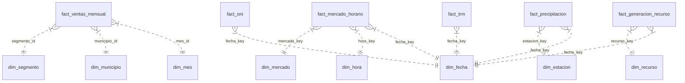

# Modelo dimensional del Observatorio Energía y Clima

## 1. Propósito

El proyecto integra información de energía, clima y comercio para analizar la relación entre:

- precio de bolsa y demanda del mercado eléctrico (XM)
- generación por recurso y ventas (EnerAndes)
- precipitación y temperatura (IDEAM)
- anomalía climática global ONI (NOAA)
- tasa de cambio (TRM)

El objetivo del modelo dimensional es estructurar estos datos para BI, reporting y análisis analítico sin mezclar atributos descriptivos con métricas transaccionales.

## 2. Arquitectura recomendada

El flujo de datos del proyecto se organiza en capas:

- Bronce: datos crudos extraídos desde APIs, Excel o archivos.
- Plata: limpieza, validación, normalización y tipos.
- Oro: modelo dimensional para consumo analítico.

La capa oro debe estar orientada a un esquema en estrella con tablas de hechos y dimensiones.

## 3. Modelo estrella

Este diagrama representa el patrón estrella: cada tabla de hechos se relaciona con sus dimensiones de contexto y mantiene métricas medibles, mientras que las dimensiones aportan descripciones del negocio.

## 4. Dimensiones recomendadas

### 4.1. dim_mes

Descripción: dimensión temporal mensual.

Campos sugeridos:
- mes_id (PK)
- anio
- mes
- nombre_mes
- trimestre

Uso: análisis de tendencias mensuales y comparaciones anuales.

### 4.2. dim_municipio

Descripción: ubicación territorial asociada a ventas o consumo.

Campos sugeridos:
- municipio_id (PK)
- municipio
- departamento
- region
- zona

Uso: segmentación geográfica del comportamiento del sistema energético.

### 4.3. dim_segmento

Descripción: tipo de cliente, actividad o segmento comercial.

Campos sugeridos:
- segmento_id (PK)
- segmento
- categoria
- descripcion

Uso: análisis por tipo de cliente o negocio.

### 4.4. dim_fecha

Descripción: calendario base para análisis temporal.

Campos sugeridos:
- fecha_key (PK)
- fecha
- anio
- mes
- dia
- nombre_dia
- trimestre
- es_fin_de_semana

Uso: unión entre clima, energía, mercado y tasa de cambio.

### 4.5. dim_hora

Descripción: dimensión horaria para el mercado eléctrico.

Campos sugeridos:
- hora_key (PK)
- hora
- hora_inicio
- hora_fin
- periodo_dia

Uso: análisis de picos, comportamiento intradiario y variación por franja.

### 4.6. dim_mercado

Descripción: tipo de mercado o indicador energético.

Campos sugeridos:
- mercado_key (PK)
- codigo_mercado
- nombre_mercado
- tipo_mercado
- descripcion

Uso: distinguir bolsa, demanda, generación o embarque energético.

### 4.7. dim_recurso

Descripción: planta o recurso de generación eléctrica, descrito por el catálogo
XM `ListadoRecursos` y vinculado con la generación horaria por su código.

Campos:
- recurso_key (PK)
- codigo_recurso
- nombre_recurso
- tipo_generacion
- fuente_energia
- empresa
- disponibilidad
- estado

Uso: comparar producción por recurso (hidráulica, térmica, solar, eólica, etc.).

### 4.8. dim_estacion

Descripción: estación climatológica de IDEAM.

Campos sugeridos:
- estacion_key (PK)
- codigo_estacion
- nombre_estacion
- municipio
- departamento
- latitud
- longitud

Uso: análisis de precipitación y temperatura por zona.

## 5. Tablas de hechos y grano de negocio

### 5.1. fact_ventas_mensual

Grano: 1 fila por mes + municipio + segmento + tipo de compra.

Esto significa que cada registro representa el total vendido en un municipio durante un mes para un segmento específico. Es el nivel ideal para responder:
- ¿Cuánto se vendió por municipio cada mes?
- ¿Qué segmento crece más?
- ¿Cómo cambia la venta por territorio?

Campos sugeridos:
- mes_id
- municipio_id
- segmento_id
- ventas_mwh
- ingresos_cop
- ingresos_usd
- fuente

### 5.2. fact_mercado_horario

Grano: 1 fila por fecha + hora, con precio y demanda total del sistema.

Cada fila describe el comportamiento del mercado eléctrico en una hora exacta. Permite analizar:
- precio por hora
- demanda por franja horaria
- volatilidad del mercado durante el día

Campos sugeridos:
- fecha_key
- hora_key
- mercado_key
- precio_cop_kwh
- demanda_mwh
- volumen_embalses_pct
- fuente

### 5.3. fact_generacion_recurso

Grano: 1 fila por fecha + hora + planta (código de recurso).

Cada registro representa la generación asociada a una fuente de energía en un día determinado. Se usa para responder:
- ¿Qué recurso generó más energía?
- ¿Cómo cambia la oferta por tipo de recurso?
- ¿Qué relación existe entre recurso y clima?

Campos sugeridos:
- fecha_key
- recurso_key
- generacion_mwh
- capacidad_instalada_mw
- factor_carga
- fuente

### 5.4. fact_precipitacion

Grano: 1 fila por fecha + estación.

Cada fila representa la observación meteorológica de una estación en un día. Sirve para:
- estudiar lluvias y sequía
- analizar anomalías térmicas
- relacionar clima local con riesgo energético

Campos sugeridos:
- fecha_key
- estacion_key
- precipitacion_mm
- temperatura_media_c
- temperatura_max_c
- temperatura_min_c
- n_obs
- fuente

### 5.5. fact_oni

Grano: 1 fila por fecha o periodo mensual asociado a la anomalía climática global.

Es la tabla que conecta la señal climática global con el comportamiento local del sistema. Se usa para evaluar:
- El Niño / La Niña
- riesgo hidrológico
- impacto sobre precios y generación

Campos sugeridos:
- fecha_key
- indice_oni
- anomalia
- fase_climatica
- fuente

### 5.6. fact_trm

Grano: 1 fila por fecha.

Se utiliza para convertir indicadores monetarios a USD y comparar la evolución de precios con la tasa de cambio.

Campos sugeridos:
- fecha_key
- trm_promedio
- trm_cierre
- fuente

## 6. Recomendaciones de diseño

1. Mantener una clave de fecha común para unir clima, mercado y generación.
2. Usar claves surrogate para cada dimensión.
3. Evitar incluir atributos descriptivos en las tablas de hechos.
4. Definir un solo grano por tabla para evitar duplicaciones y dobles conteos.
5. Guardar la trazabilidad de origen documental y de extracción.
6. Crear vistas agregadas para dashboards y reportes frecuentes.

## 7. Conclusión

El modelo dimensional recomendado para este proyecto se centra en una estructura de estrella que conecta los hechos energéticos y climáticos con sus dimensiones de contexto. El elemento central es la fecha, que permite unir precio, demanda, generación, clima y tasa de cambio en una sola visión analítica.

El grano más importante del modelo es:
- fact_ventas_mensual: mes + municipio + segmento + tipo de compra
- fact_mercado_horario: fecha + hora
- fact_generacion_recurso: fecha + hora + recurso
- fact_precipitacion: fecha + estación

Con esta estructura, el proyecto puede responder preguntas de negocio y de riesgo energético con análisis más claros, reutilizables y compatibles con BI.
